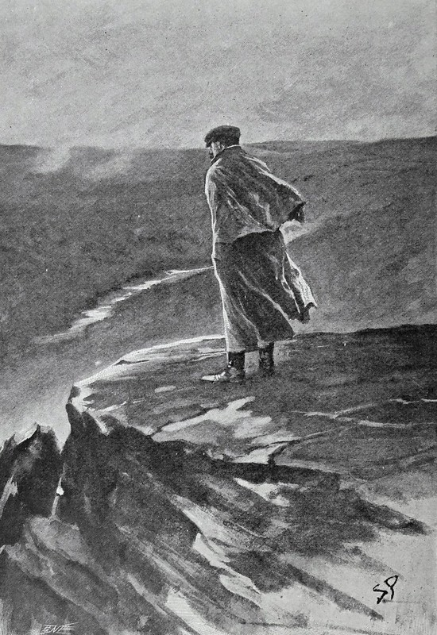

Me fascinan las historias de misterio. Siempre me ha gustado intentar adivinar quién es el culpable y seguir cada paso del detective, y aun así nunca había leído la novela más famosa de Sherlock Holmes.<!-- excerpt-end --> Cuando por fin me decidí con *El sabueso de los Baskerville*, la devoré en cuestión de horas.

La historia arranca en Londres. El doctor Mortimer llega a Baker Street con un manuscrito antiguo sobre una maldición familiar: un perro infernal que persigue a los Baskerville desde el siglo XVII. Sir Charles, el último señor de la casa, acaba de aparecer muerto en su finca de Dartmoor, con el rostro desencajado por el terror. Junto al cuerpo, Mortimer vio algo que no se atrevió a contar en la investigación: «Señor Holmes, ¡eran las huellas de un sabueso gigantesco!».

Es la tercera de las cuatro novelas de Holmes, y se publicó por entregas en *The Strand Magazine* entre agosto de 1901 y abril de 1902. Fue un éxito enorme, de esos que me recuerdan a la espera de cada nuevo libro de *Harry Potter*. Y tiene su historia: Conan Doyle había matado a Holmes en 1893 y llevaba ocho años sin escribir sobre él. El sabueso nació de una leyenda que le contó su amigo Bertram Fletcher Robinson, natural de Dartmoor, y Doyle visitó el páramo en 1901 antes de escribirla. Para no resucitar a su detective, situó el caso antes de su muerte.

Lo que más me sorprendió es lo poco que aparece Holmes. Envía a Watson a Dartmoor con el heredero, sir Henry, y durante buena parte de la novela lo que leemos son sus cartas y su diario desde la mansión. El protagonista real es Watson, solo en el páramo, rodeado de niebla, de un preso fugado y de unos vecinos que esconden algo. Cuando Holmes reaparece, lo hace por sorpresa, y ese giro funciona precisamente porque lo hemos echado de menos.

El otro tema que me resultó interesante es el choque entre la razón y la superstición. En Londres, Holmes y Watson ven la leyenda como un cuento local. En el campo, con los aullidos en la noche y las ciénagas que se tragan a quien se sale del camino, Watson empieza a dudar. Los habitantes de Devonshire creen en la maldición, y son dos hombres de ciudad los que llegan para desmontarla con lógica. Doyle juega con los dos mundos hasta el final: el ambiente es de novela gótica, pero la explicación siempre es racional.

Holmes no fue el primer detective de la ficción, porque antes estuvieron Poe y Gaboriau, pero su nombre se ha vuelto sinónimo del género. Al leer esta novela entiendo por qué. La escritura de Doyle es precisa y directa, la narración en primera persona de Watson te mete en la historia, y cada personaje tiene su propio secreto.

Más de cien años después, *El sabueso de los Baskerville* sigue siendo entretenida e ingeniosa: el triunfo del razonamiento sobre el miedo, en el escenario más oscuro que Doyle encontró para su detective. No me sorprende que siga siendo una lectura imprescindible para cualquier amante del misterio.
