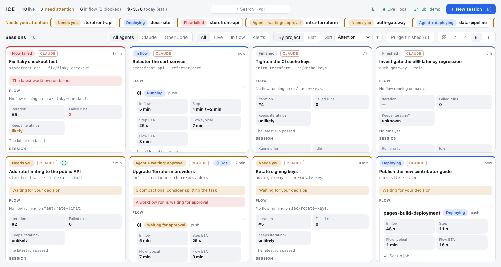

En abril de 2025 se publicó [*AI 2027*](https://ai-2027.com/), un escenario que contaba, mes a mes, cómo podría llegar una inteligencia artificial superhumana. Casi todo el texto habla de geopolítica y de riesgos, pero hay una línea, fechada a finales de 2026, que entonces sonaba a ciencia ficción: a los programadores que mejor les iría serían los que supieran «gestionar y controlar la calidad de equipos de IA».<!-- excerpt-end -->

Es finales de 2026. Todavía no existen las doscientas mil copias de agentes que imaginaba el escenario, pero un desarrollador ya puede tener abiertas decenas de sesiones a la vez. Y hay algo que *AI 2027* daba por hecho sin explicarlo nunca: con qué herramienta se supervisa todo eso. Esa herramienta todavía no está resuelta.

## Ya no se abre el IDE

El [post anterior](/ya-no-revisamos-codigo) contaba cómo se había dejado de revisar cada cambio a mano. La consecuencia lógica llegó sola: si el código no se lee antes de integrar el cambio, el editor deja de ser la herramienta en la que apoyarse. Hoy no se usa ningún IDE: se trabaja con agentes en la terminal y se delega todo el trabajo posible en flujos agénticos que se ejecutan en GitHub.

No es una preferencia ni una pose, sino una **prueba de madurez**. Dejar el IDE solo es posible cuando el resto del sistema es lo bastante bueno como para no necesitar mirar el código: una especificación ejecutable, puertas que bloquean, permisos claros y trazabilidad de cada cambio. Si para confiar en lo que ha hecho un agente todavía hay que abrir el editor y leerlo, el problema no es la herramienta: es que el sistema aún no está listo.

Esto tiene nombre: *software factory*. [StrongDM](https://simonwillison.net/2026/feb/7/software-factory/) lo popularizó este año para describir un equipo donde los agentes escriben y prueban el código, y las personas ni lo escriben ni lo revisan. Cuando se lleva al extremo se llama *dark factory*, como las fábricas que trabajan a oscuras porque los robots no necesitan luz. Pero oscuridad no significa ausencia de control: StrongDM lo mueve de la lectura del código a escenarios de validación que los agentes no ven y a réplicas de los servicios contra los que prueban. El enfoque va en la misma línea, con el control en las puertas, y deja la misma pregunta abierta: desde dónde se supervisa todo eso.

## La paradoja

Los datos dicen lo contrario de lo que se ve en el día a día, o eso parece. En la [encuesta de Stack Overflow de 2026](https://visualstudiomagazine.com/articles/2026/10/06/stack-overflow-2026-survey-vs-code-leads-visual-studio-takes-third.aspx), VS Code sigue siendo el IDE más usado. Pero en la misma encuesta, Claude Code es el agente más usado, con un 65,5 %, y el uso de agentes ha pasado del 31 % en 2025 al 59 % en abril de este año.

Todo el mundo tiene el IDE instalado. Cada vez menos gente trabaja dentro de él. Y los fabricantes lo saben:

- Microsoft lanzó [VS Code Agents](https://www.infoworld.com/article/4156038/visual-studio-code-1-115-introduces-vs-code-agents-app.html), una aplicación aparte del editor para lanzar y seguir sesiones de agentes en paralelo. La novedad de Visual Studio 2026 se resumió con un titular que lo dice todo: [asigna una tarea, cierra el IDE, recibe una PR](https://visualstudiomagazine.com/articles/2026/04/29/vs-2026-joins-vs-code-with-integrated-cloud-agent-assign-a-task-close-the-ide-get-a-pr.aspx).
- Cursor 3 estrenó una [ventana de agentes](https://www.datacamp.com/blog/cursor-3) construida desde cero alrededor de los agentes, no del editor de archivos.
- JetBrains lanzó [Air](https://tech-insider.org/jetbrains-air-eap-ides-multi-agent-2026/), un orquestador de varios agentes que ni siquiera trae agentes propios: ejecuta los que tengas instalados.
- Y Microsoft lo llevó también a la terminal: [Intelligent Terminal 0.3](https://github.com/microsoft/intelligent-terminal/releases), un *fork* de Windows Terminal con una barra lateral que muestra qué agentes están trabajando o esperándote, con su repositorio y su rama.

Los cuatro hacen lo mismo: construir, al lado del editor o en su lugar, una ventana para los agentes. Es la forma más honesta de reconocer que el trabajo ya no pasa por el editor. Pero también es una solución a medias: siguen pensando en conversaciones y en una sola persona delante de una sola máquina.

## Sesiones, no conversaciones

Esta es la distinción que importa.

Una **conversación** es un chat: preguntas, el modelo responde, sigues preguntando. Está pensada para una persona y un agente, y para que la persona esté delante.

Una **sesión** es un trabajo en marcha. Tiene un objetivo (una *issue*, una especificación), una rama o un *worktree*, unos permisos, un coste acumulado, un estado (trabajando, bloqueada, esperando una decisión, en revisión) y un resultado que se puede verificar: las puertas que ha pasado y las que no.

Con una conversación, la pregunta es *qué ha dicho*. Con decenas de sesiones, las preguntas son otras: cuáles necesitan atención ahora, cuáles se han atascado, cuáles están gastando sin avanzar y cuáles puedo dar por buenas sin mirarlas.

Hoy se resuelve con lo más simple que hay: varias pestañas en una terminal, una por sesión, que normalmente es una por *feature* o por *issue*. Con los flujos agénticos se espera a que terminen y se miran las métricas en el panel de *health* de la plataforma. La terminal funciona mientras son pocas. Cuando son más de cinco, deja de ser una herramienta útil y se convierte en un cuadro eléctrico sin etiquetas.

Y ahí es donde se nota lo que falta. Saber qué sesión espera una decisión sin ir pestaña por pestaña. Saber si una ya ha entrado en el flujo de despliegue, o si una puerta ha fallado en alguna parte de ese flujo y el agente está reimplementando, lo que puede ser señal de que hay algo que optimizar. Saber cuánto lleva consumido de la ventana de contexto. Y la lista no acaba ahí: cada sesión que se suma trae preguntas nuevas, y ninguna pestaña tiene la respuesta a la vista.

Y todo eso es dentro de un solo proyecto. Un equipo altamente efectivo no lleva uno, sino varios a la vez, cada uno con sus sesiones, sus despliegues y sus dependencias. Las pestañas de una terminal son de una persona; el trabajo es del equipo. Lo que hace falta no es una ventana por persona, sino un panel compartido en el que todo el equipo vea lo mismo: qué sesiones hay en marcha en cada proyecto, quién atiende cada una y qué está esperando a quién.

## Cómo debería ser el nuevo IDE

Si el IDE clásico era un editor con herramientas alrededor, el nuevo es una consola de operaciones: la sala de control de una *software factory*. El sector lleva tiempo llamándolo [**ADE**](https://www.warp.dev/articles/what-is-an-agentic-development-environment), *Agentic Development Environment*. Aquí conviene cambiar otra letra: no un entorno de desarrollo, sino un **ICE**, un *Integrated Control Environment*. La D de desarrollo deja paso a la C de control: ya no es el sitio donde se escribe el código, sino desde donde se supervisa a quienes lo escriben.

Sin pretender un diseño cerrado, esto es lo que necesita un ICE:

1. **Una bandeja de decisiones, no de mensajes.** Lo primero que aparece no es código ni chats, sino lo que está esperando una decisión: una sesión que pide permiso para tocar algo sensible, una especificación ambigua, un *gate* que ha fallado dos veces.
2. **El estado de cada sesión de un vistazo.** Trabajando, bloqueada, esperando, lista. En qué punto del flujo de despliegue está, si alguna puerta ha fallado y cuántas veces y cuánto tiempo lleva reimplementando. Como un tablero de despliegues, no como una lista de pestañas.
3. **Varios proyectos, un panel compartido.** Las sesiones se agrupan por proyecto, pero se ven juntas, y el panel es del equipo, no de una persona: todos ven lo mismo, se sabe quién atiende cada sesión y cualquiera con contexto puede tomar una decisión pendiente.
4. **Evidencias antes que *diffs*.** De cada sesión debe verse primero qué puertas ha pasado (tests, mutación, seguridad, especificación) y solo después, si hace falta, el cambio o la conversación del agente con sus acciones y su razonamiento. Leer el código modificado línea a línea, o repasar cada paso que dio el agente, deja de ser la puerta de entrada.
5. **Coste y presupuesto por sesión.** Cuánto lleva gastado, cuánto se espera que gaste y cuándo pararla. Una sesión que da vueltas es dinero que se va. Y cuántas veces ha llegado al tope de la ventana de contexto: una sesión que se compacta una y otra vez pierde memoria y gasta de más, y suele ser la señal de que hay algo que optimizar, como una tarea demasiado grande, un contexto inflado con archivos que no hacían falta o una especificación que habría que partir.
6. **Permisos y líneas rojas visibles.** Qué puede hacer cada sesión, qué no, y cuándo se va a detener para pedir confirmación. Y de quién depende: si para desplegar necesita algo de otro equipo, tiene que saberse antes de empezar y no cuando ya está bloqueada, junto con una estimación de cuánto le falta para terminar.
7. **Trazabilidad de punta a punta.** De la *issue* a la especificación, de la especificación a la sesión, de la sesión a la PR y de la PR a producción. Si algo falla en producción, tiene que poder seguirse hacia atrás.
8. **Pausar, retomar y reasignar.** Las sesiones duran horas. Tienen que poder pararse, retomarse con su contexto y asignarse a otra persona.
9. **Un límite de trabajo en curso.** Tener cien sesiones abiertas no es productividad si nadie puede atenderlas. La herramienta debería ayudar a no lanzar más de las que se pueden supervisar.

Lo que no aparece en la lista es escribir código. El editor no desaparece, pero pasa a ser una vista más, la que se abre en el caso raro en que de verdad hace falta leer algo.

## Una primera versión: ICE

Lo bueno de tener claro lo que falta es que se puede empezar a construir. PlainConcepts ha publicado como proyecto de código abierto una primera versión: [**ICE**](https://github.com/PlainConceptsPlatform/ice), *Integrated Control Environment*. Es una interfaz web local para supervisar y dirigir sesiones de Claude Code y de OpenCode. No es un editor ni pretende serlo: sustituye al IDE como sitio de trabajo. No escribe el código, de eso se encargan los agentes; es la consola desde la que se supervisan muchas sesiones de muchos proyectos.

*Captura del repositorio, en modo demo: todas las sesiones y proyectos son inventados.*

Cubre una parte de la lista de arriba: hasta 16 sesiones por pantalla, con su estado, el flujo de CI con tiempo estimado, las PR, los tokens, el coste y las compactaciones repetidas; una barra con lo que necesita una decisión tuya; y la posibilidad de responder permisos, enviar mensajes y retomar sesiones sin salir de la página. Es una primera versión y tiene límites claros: es local, para una persona, y el panel compartido por el equipo sigue pendiente.

## Esto no es nada nuevo

Conviene bajar el tono: esto no es nada nuevo ni extraordinario. Hacer una terminal, o un panel como este, es literalmente un *prompt* y media hora de ajustes. Todo el mundo tiene ahora la capacidad de construirse la herramienta y adaptarla a cómo trabaja, y todo el mundo lo está haciendo. ICE es una más.

Por eso no hay un ganador claro ni lo habrá pronto. Cuando construir cuesta una tarde, cada equipo hace el suyo, a su medida. Habrá tantos ICE como equipos, y no habrá uno rígido que valga para todos: cada equipo tiene sus propias puertas, sus flujos y sus líneas rojas, y su consola tendrá que reflejarlos. La lista de arriba no es una especificación, sino un punto de partida para que cada uno construya la suya. Lo que no se puede delegar en ninguna herramienta es saber qué hay que mirar.

## Lo que no es

No es un chat con pestañas. Tampoco es el editor de siempre con un panel lateral para el agente. Y no es una herramienta personal: si las sesiones son trabajo del equipo y abarcan varios proyectos, el nuevo IDE es, sobre todo, un panel compartido.

Steve Yegge lo describe como el momento en que [tu IDE desaparece y no vuelves a abrirlo nunca](https://newsletter.pragmaticengineer.com/p/from-ides-to-ai-agents-with-steve), y ahora habla de que el IDE volverá, pero como centro de control de agentes. La segunda parte es la acertada. Lo que vuelve no es el editor: es la necesidad de un sitio donde trabajar.

## Una prueba de madurez

Antes de dejar el IDE, o de presumir de haberlo dejado, conviene hacerse unas pocas preguntas:

- ¿Se puede saber si un cambio es correcto sin leerlo?
- ¿Las puertas bloquean de verdad, o solo avisan?
- ¿Se sabe qué puede tocar cada agente y qué no?
- ¿Se puede seguir un incidente de producción hasta la sesión que lo provocó?
- ¿Se sabe cuánto cuesta cada cambio?

Si la respuesta a alguna es no, el IDE todavía hace falta. No porque se escriba código en él, sino porque es la última red de seguridad.

## El IDE que falta

*AI 2027* imaginaba ingenieros que ya no programan y se pasan el día intentando seguir el ritmo de lo que producen los agentes. La primera parte ya se está viviendo. La segunda la intentan resolver muchas herramientas, pero casi todas se quedan en una persona y en una máquina. Y seguir el ritmo no puede consistir en ir de conversación en conversación.

Hace falta una visión holística del sistema, y con dos condiciones:

- **Compartida.** Las sesiones de un proyecto y sus dependencias son del equipo, no de quien las lanzó, y se ven igual se ejecuten donde se ejecuten, en local o en la nube.
- **Completa.** No solo el trabajo de los agentes generando código, sino todo lo que pasa alrededor: las puertas que se ejecutan o han fallado, los despliegues en marcha, los flujos que esperan un *runner* o una aprobación, los permisos pendientes, el coste y las dependencias con otros equipos.

Los modelos seguirán cambiando cada pocos meses, y las herramientas también. Lo que no va a cambiar es que alguien tiene que decidir qué se construye, comprobar que lo que ha salido es lo que se pidió y responder por ello. El nuevo IDE no es el sitio donde se escribe el código. Es el sitio desde el que se responde por él.
